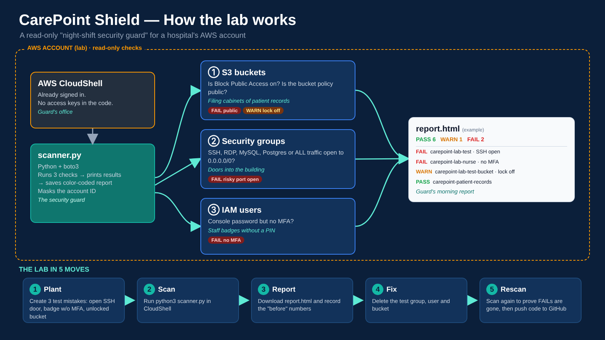

# CarePoint Shield 🛡️

**A beginner-friendly AWS security lab.** You run a small, read-only Python scanner in AWS CloudShell that finds three common cloud security mistakes and writes a color-coded report.



> **Think of it like this:** CarePoint Health is a fictional small hospital that runs on AWS. The scanner is a night-shift security guard. It walks the building and checks for unlocked filing cabinets, open doors and staff badges without a PIN. It only **looks**. It never changes anything.

---

## Table of contents

1. [What the scanner checks](#1-what-the-scanner-checks)
2. [Before you start](#2-before-you-start)
3. [Stage 1 – Open CloudShell and get the code](#stage-1--open-cloudshell-and-get-the-code)
4. [Stage 2 – Plant three test problems](#stage-2--plant-three-test-problems)
5. [Stage 3 – Run each check one by one](#stage-3--run-each-check-one-by-one)
6. [Stage 4 – Run the full scan and view the report](#stage-4--run-the-full-scan-and-view-the-report)
7. [Stage 5 – Fix the problems and clean up](#stage-5--fix-the-problems-and-clean-up)
8. [Troubleshooting](#troubleshooting)
9. [How the code works](#how-the-code-works)
10. [Ideas to extend the lab](#ideas-to-extend-the-lab)

---

## 1. What the scanner checks

| # | Check | Hospital version | Result |
|---|---|---|---|
| 1 | **S3 buckets** | Filing cabinets of patient records | **FAIL** if a bucket policy makes it public · **WARN** if Block Public Access is not fully on |
| 2 | **Security groups** | Doors into the building | **FAIL** if SSH (22), RDP (3389), MySQL (3306), PostgreSQL (5432) or ALL traffic is open to `0.0.0.0/0` · **WARN** for other open ports (80 and 443 are OK) |
| 3 | **IAM users** | Staff badges | **FAIL** if a user has a console password but **no MFA** |

Everything else shows **PASS**.

---

## 2. Before you start

### What you need

- [ ] An **AWS account you use for practice**. ⚠️ Do **not** use a work or production account.
- [ ] A user or role in that account that can **create and delete** a security group, an IAM user and an S3 bucket (for the test problems). An admin user in your own practice account is fine.
- [ ] About **45–60 minutes**.

### Cost

**$0.** An empty security group, an IAM user with no permissions and an empty S3 bucket are all free. Stage 5 deletes them anyway.

### Safety rules

1. The scanner is **read-only**. It never changes your account.
2. Stage 2 creates three harmless **test problems** so the scanner has something to find. **Always finish Stage 5** to delete them.
3. **Never** paste passwords, access keys or tokens into chat, screenshots or code.
4. Your account ID is shown masked (`********1234`) in the report. Still hide it before sharing screenshots of the terminal.

### How each step is written

Every step has the same four parts:

- **Purpose** – why you are doing it
- **Command** – **one** command. Copy it, paste it into CloudShell, press **Enter**
- **Expected** – what you should see
- **If it fails** – what to try (only on some steps)

Do not move to the next step until your output matches **Expected**.

---

## Stage 1 – Open CloudShell and get the code

### Step 1.1 – Open AWS CloudShell

- **Purpose:** CloudShell is a terminal inside the AWS Console. It is already signed in as you, so you do **not** need access keys.
- **Action:**
  1. Sign in to the **AWS Console** (your practice account).
  2. In the top-right region menu, choose **US East (N. Virginia) us-east-1** (any region with a default VPC works).
  3. Click the **CloudShell icon** `>_` in the top bar.
  4. Wait until you see a prompt like `[cloudshell-user@ip-10-... ~]$`.

### Step 1.2 – Check Python

- **Purpose:** The scanner is written in Python.
- **Command:**

```bash
python3 --version
```

- **Expected:** `Python 3.9` or newer.

### Step 1.3 – Check boto3

- **Purpose:** `boto3` is the Python library that talks to AWS. CloudShell usually has it already.
- **Command:**

```bash
python3 -c "import boto3; print(boto3.__version__)"
```

- **Expected:** A version number, for example `1.34.x`.
- **If it fails:** If you see `ModuleNotFoundError`, run `pip3 install --user boto3`, then run the command again.

### Step 1.4 – Confirm you are in the right account

- **Purpose:** Make sure you are in your **practice** account before creating anything.
- **Command:**

```bash
aws sts get-caller-identity --query Account --output text
```

- **Expected:** A 12-digit account ID. Check that it is your practice account.

### Step 1.5 – Download the code

- **Purpose:** Copy this repository into CloudShell.
- **Command:**

```bash
git clone https://github.com/mrubelcyber/carepoint-security-scanner.git
```

- **Expected:** `Cloning into 'carepoint-security-scanner'...` and then `done`.

### Step 1.6 – Go into the project folder

- **Purpose:** All the next commands run from inside this folder.
- **Command:**

```bash
cd carepoint-security-scanner
```

- **Expected:** No output. Your prompt now ends with `carepoint-security-scanner]$`.

### Step 1.7 – Look at the files

- **Purpose:** Make sure you have everything.
- **Command:**

```bash
ls
```

- **Expected:** You see `README.md  iam_check.py  lab-overview.png  s3_check.py  scanner.py  sg_check.py`.

✅ **Checkpoint 1:** You are in the project folder in CloudShell, in your practice account.

---

## Stage 2 – Plant three test problems

A brand-new account is usually clean, so the scanner would only show PASS. In this stage you create **three safe test problems** so you can watch the scanner catch them.

### Step 2.1 – Create a test security group (a "door")

- **Purpose:** Make an empty security group. It is not attached to any server, so it is harmless.
- **Command:**

```bash
aws ec2 create-security-group --group-name carepoint-lab-test --description "CarePoint lab test - delete me" --query GroupId --output text
```

- **Expected:** A group ID like `sg-0abc123def4567890`.
- **If it fails:** `VPCIdNotSpecified` means this region has no default VPC. Switch CloudShell to another region (for example `us-east-1`) and start again from Step 1.5.

### Step 2.2 – Open SSH to the whole internet on it

- **Purpose:** This is test problem #1, the mistake the scanner should catch.
- **Command:**

```bash
aws ec2 authorize-security-group-ingress --group-name carepoint-lab-test --protocol tcp --port 22 --cidr 0.0.0.0/0
```

- **Expected:** JSON output that includes `"Return": true`.

### Step 2.3 – Create a test IAM user (a "staff badge")

- **Purpose:** Make a user with **no permissions**.
- **Command:**

```bash
aws iam create-user --user-name carepoint-lab-nurse
```

- **Expected:** JSON that includes `"UserName": "carepoint-lab-nurse"`.

### Step 2.4 – Give the badge a console password but no MFA

- **Purpose:** This is test problem #2. The password is **random and never shown**, so nothing sensitive appears on screen.
- **Command:**

```bash
aws iam create-login-profile --user-name carepoint-lab-nurse --password "$(openssl rand -base64 18)Aa1!" --password-reset-required
```

- **Expected:** JSON that includes `"PasswordResetRequired": true`. No password is printed.
- **If it fails:** `PasswordPolicyViolation` means your account has a strict password policy. Run the command again; the random password changes each time.

### Step 2.5 – Pick a unique name for the test bucket

- **Purpose:** S3 bucket names must be unique worldwide. This creates a random name and saves it, so it is still there if CloudShell restarts.
- **Command:**

```bash
echo "export LAB_BUCKET=carepoint-lab-test-$RANDOM$RANDOM" >> ~/.bashrc && source ~/.bashrc && echo $LAB_BUCKET
```

- **Expected:** A name like `carepoint-lab-test-1834527791`. **Write it down.**

### Step 2.6 – Create the test bucket (a "filing cabinet")

- **Purpose:** Make an empty, private bucket.
- **Command:**

```bash
aws s3 mb s3://$LAB_BUCKET
```

- **Expected:** `make_bucket: carepoint-lab-test-...`

### Step 2.7 – Turn off the bucket's safety lock

- **Purpose:** This is test problem #3. The bucket is still private, but **Block Public Access** is off, so the scanner should **WARN**.
- **Command:**

```bash
aws s3api delete-public-access-block --bucket $LAB_BUCKET
```

- **Expected:** No output means it worked.

✅ **Checkpoint 2:** You now have one open test door, one badge without a PIN and one unlocked filing cabinet. **Nothing is public.**

---

## Stage 3 – Run each check one by one

Run each check alone first, so you understand what each one does.

### Step 3.1 – Check the filing cabinets (S3)

- **Purpose:** For every bucket, ask: is Block Public Access fully on, and does a bucket policy make it public?
- **Command:**

```bash
python3 s3_check.py
```

- **Expected:** Your test bucket shows:

```
[WARN] carepoint-lab-test-1834527791 - Block Public Access is not fully turned on
```

  Your other buckets (if any) should show `PASS`.

### Step 3.2 – Check the doors (security groups)

- **Purpose:** For every security group, look for risky ports open to the whole internet.
- **Command:**

```bash
python3 sg_check.py
```

- **Expected:** Your test group shows:

```
[FAIL] sg-0abc... (carepoint-lab-test) - SSH open to the internet
```

  The `default` group usually shows `PASS`.

### Step 3.3 – Check the staff badges (IAM MFA)

- **Purpose:** For every user, ask: can they log in to the console, and do they have MFA?
- **Command:**

```bash
python3 iam_check.py
```

- **Expected:** Your test user shows:

```
[FAIL] carepoint-lab-nurse - Console password but NO MFA
```

✅ **Checkpoint 3:** Each check found its test problem.

---

## Stage 4 – Run the full scan and view the report

### Step 4.1 – Run all checks together

- **Purpose:** `scanner.py` runs all three checks, prints a summary and saves an HTML report.
- **Command:**

```bash
python3 scanner.py
```

- **Expected:** Something like this (your names and numbers will be different):

```
CarePoint Shield scan - account ********9012 - 2026-11-15 03:09 UTC
[PASS ] S3              carepoint-app-logs - Block Public Access is on
[WARN ] S3              carepoint-lab-test-1834527791 - Block Public Access is not fully turned on
[PASS ] Security Group  sg-0c1f... (default) - No risky internet access
[FAIL ] Security Group  sg-0e58... (carepoint-lab-test) - SSH open to the internet
[FAIL ] IAM MFA         carepoint-lab-nurse - Console password but NO MFA
Summary: PASS=..., WARN=1, FAIL=2, ERROR=0
Report saved to report.html
```

📝 **Write down your "before" numbers:** PASS ___ WARN ___ FAIL ___

### Step 4.2 – Download the report

- **Purpose:** See the report the way a manager would.
- **Action:**
  1. In CloudShell, click **Actions** (top right) → **Download file**.
  2. Type this path: `carepoint-security-scanner/report.html`
  3. Click **Download**, then open the file in your web browser.
- **Expected:** A table with **FAIL rows in red at the top**, then WARN in orange, then PASS in green.

> 🔒 `report.html` contains details about your account. It is listed in `.gitignore` so it is never uploaded to GitHub. Do not share it publicly.

✅ **Checkpoint 4:** The report shows all three test problems.

---

## Stage 5 – Fix the problems and clean up

⚠️ **Do not skip this stage.** It removes the test problems and proves the fix.

### Step 5.1 – Close the open door

- **Purpose:** Delete the test security group.
- **Command:**

```bash
aws ec2 delete-security-group --group-name carepoint-lab-test
```

- **Expected:** No output, or JSON with `"Return": true`.

### Step 5.2 – Remove the badge's password

- **Purpose:** AWS requires removing the console password before deleting the user.
- **Command:**

```bash
aws iam delete-login-profile --user-name carepoint-lab-nurse
```

- **Expected:** No output.

### Step 5.3 – Remove the test badge

- **Purpose:** Delete the test user.
- **Command:**

```bash
aws iam delete-user --user-name carepoint-lab-nurse
```

- **Expected:** No output.

### Step 5.4 – Remove the test filing cabinet

- **Purpose:** Delete the empty test bucket.
- **Command:**

```bash
aws s3 rb s3://$LAB_BUCKET
```

- **Expected:** `remove_bucket: carepoint-lab-test-...`
- **If it fails:** If `$LAB_BUCKET` is empty, run `source ~/.bashrc` first, or type the bucket name you wrote down in Step 2.5.

### Step 5.5 – Scan again to prove the fix

- **Purpose:** A before/after comparison proves the problems are really gone.
- **Command:**

```bash
python3 scanner.py
```

- **Expected:** No `carepoint-lab-test` or `carepoint-lab-nurse` lines. The FAIL and WARN counts went down.

📝 **Write down your "after" numbers:** PASS ___ WARN ___ FAIL ___

### Step 5.6 – Remove the saved bucket name (optional)

- **Purpose:** Tidy up the line added to your CloudShell settings in Step 2.5.
- **Command:**

```bash
sed -i '/LAB_BUCKET/d' ~/.bashrc
```

- **Expected:** No output.

🎉 **Lab complete!** You built and tested a working cloud security check, and left the account clean.

---

## Troubleshooting

| What you see | What it means | What to do |
|---|---|---|
| `ModuleNotFoundError: No module named 'boto3'` | boto3 is missing | `pip3 install --user boto3` |
| `VPCIdNotSpecified` | This region has no default VPC | Switch CloudShell to `us-east-1` and start again from Step 1.5 |
| `AccessDenied` or `UnauthorizedOperation` | Your user lacks a permission | Use an admin user in your practice account, or add the permissions listed below |
| `EntityAlreadyExists` / `InvalidGroup.Duplicate` | You ran a Stage 2 step twice | That's fine, the test problem already exists. Go to the next step |
| `BucketAlreadyExists` | Someone in the world already uses that name | Run Step 2.5 again to get a new random name |
| `DeleteConflict` when deleting the user | The login profile still exists | Run Step 5.2 first, then Step 5.3 |
| `DependencyViolation` when deleting the group | The group is attached to something | Make sure you did not attach it to an EC2 instance; detach it, then retry |
| `$LAB_BUCKET` is empty | CloudShell restarted | `source ~/.bashrc` |
| A bucket shows `ERROR` | That bucket is in a region the scanner could not read | Safe to ignore for this lab |
| CloudShell timed out | It closes after about 20–30 minutes of no activity | Reopen it, then `cd carepoint-security-scanner` and `source ~/.bashrc` |

### Permissions the scanner itself needs (read-only)

```
sts:GetCallerIdentity
s3:ListAllMyBuckets, s3:GetBucketPublicAccessBlock, s3:GetBucketPolicyStatus
ec2:DescribeSecurityGroups
iam:ListUsers, iam:GetLoginProfile, iam:ListMFADevices
```

---

## How the code works

| File | What it does |
|---|---|
| `s3_check.py` | Lists buckets → reads Block Public Access → asks AWS if the bucket policy is public |
| `sg_check.py` | Lists security groups → finds rules open to `0.0.0.0/0` or `::/0` → flags risky ports |
| `iam_check.py` | Lists users → checks for a console password → checks for an MFA device |
| `scanner.py` | Runs all three checks → prints results → writes `report.html` with the account ID masked |

Each check returns a simple list of findings, so new checks are easy to add:

```python
{"check": "S3", "resource": "bucket-name", "status": "FAIL", "detail": "why"}
```

**Note:** The security group check scans **only the region CloudShell is open in.** S3 and IAM are checked account-wide.

---

## Ideas to extend the lab

- Scan **every region**, not just one
- Add more checks: unencrypted EBS volumes, CloudTrail turned off, root account without MFA
- Run it on a **schedule** with AWS Lambda + EventBridge and send alerts with SNS
- Map each check to the **CIS AWS Foundations Benchmark** and HIPAA safeguards
- Compare the results with **AWS Security Hub**

---

## Built with

Python · boto3 · AWS CloudShell

*Built by [Md Rubel](https://github.com/mrubelcyber) as a hands-on cloud security learning lab. CarePoint Health is a fictional organization.*
